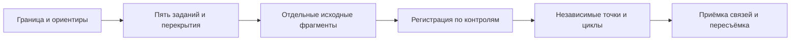

# Пять телефонов: согласованное обследование участка

Цель бригады — собрать исходники с понятным происхождением, проверить стыки и увидеть пропуски. GPS помогает найти рабочую зону; ARKit использует камеру и IMU для локального трекинга, LiDAR даёт геометрию наблюдаемых поверхностей при поддержке телефоном. Общая модель требует проверенной связи между этими наблюдениями. Заранее определите результат: карта объектов, видимая поверхность земли, фотографии надписей или метрическая 3D-сцена. Для каждого результата нужны свои ракурсы и критерии приёмки.

В текущем приложении предусмотрены планирование зон, офлайн-журналы, обмен планом, свидетельства покрытия и регистрация фрагментов по заданным соответствиям. Автоматическое узнавание всех стыков, исправление общего дрейфа и создание бесшовной модели относятся к следующему обработчику. Наличие серверного контракта не подтверждает развёрнутый сервер или подключённый x0.

1. **Подготовьте общий проект и пять заданий.** Координатор выбирает границу, отверстия, недоступные места и сотрудников. Все работают с одним действительным UUID проекта: одинаковые названия двух проектов не связывают их данные. Предложенное деление корректируется с учётом зарослей, плотности объектов и проходов. На стыках оставьте общие полосы съёмки. Ширина перекрытия зависит от дальности, видимости и режима; универсальный процент не гарантирует совмещение. При передаче задания соседу сохраняйте исполнителя, ревизию, собранные материалы и список оставшихся работ. План JSON передаёт назначения и историю; фотографии, видео и сетки передаются отдельно.

2. **Выберите и опишите контрольные ориентиры.** Подходят устойчивые марки, различимые углы конструкций и основания закреплённых столбов. Пронумеруйте их, например К001–К008; в рабочем списке и снимках соседних сотрудников используйте одни номера. Сохраните общий вид, крупный план, описание стороны объекта и источник координат. Для расчёта нужны минимум три соответствия, не лежащие на одной прямой. Разнесите их по стыку и глубине участка; короткая база около одного угла плохо контролирует дальние части. Оставьте минимум одну отдельную проверочную точку, лучше несколько: они не участвуют в подгонке. Для оценки абсолютной точности нужны независимые контрольные измерения известного качества. При их отсутствии прямо отмечайте ограничение оценки.

3. **Снимайте короткими фрагментами и проверяйте сохранение.** У каждой независимой AR-сессии остаётся собственный `frameID`. Общий проект не создаёт общий физический ноль пяти телефонов. После перезапуска, потери трекинга или продолжения на следующий день сначала проверьте состояние сессии и сохранённые материалы. Если начало отсчёта изменилось, новый фрагмент регистрируется отдельно. Снимите несколько прежних ориентиров и общий стык. Сохраняйте оригиналы, время, доступную оценку GPS, параметры камеры и происхождение геометрии. Разрыв записи остаётся ненаблюдаемым промежутком.

4. **Отмечайте покрытие по основанию.** Различайте «нет наблюдений», «пройдено», «есть материал», «проверено» и «переснять». GPS-трек фиксирует движение оператора. Фотография или скан должны действительно показывать заявленную область; специалист проверяет её полноту. У края полигона отдельно проверяются остатки ячеек и отверстия. Наблюдения соседа в полосе перекрытия полезны и сохраняют его авторство. Стрелка указывает направление; проходимость за оградами проверяйте на месте. Для пересъёмки укажите конкретную причину: закрытая земля, смазанные кадры, пропуск обратной стороны ограды или сомнительная привязка. Процент ячеек обозначайте как готовность заданий, не как автоматически измеренную долю всей поверхности.

5. **Регистрируйте фрагменты в общей метрической опоре.** Выберите опорный скан. Для остальных рассчитывается преобразование:

   `p_общая = R · p_фрагмент + t`, где `RᵀR = I` и `det(R) = +1`.

   `R` — поворот, `t` — перенос в метрах; масштаб исходника сохраняется. Проверьте единицы и вертикальные оси. Решатель показывает остатки на точках подгонки и ошибки на независимых точках. Малый остаток на одинаковых соседних памятниках может соответствовать ошибочному совпадению, поэтому нужны номера, фотографии и проверка на месте. Добавьте независимые связи для проверки циклов: путь А→Б→В→А должен возвращать согласованное положение. Разрывы и противоречия остаются видимыми. Привязка этой метрической опоры к WGS84 выполняется отдельно; GPS телефона сам её точность не подтверждает.

6. **Оценивайте качество поверхности и отправляйте комплектами.** Под кронами GPS может иметь систематическое смещение; неподвижный телефон и малая заявленная погрешность его не исключают. LiDAR наблюдает доступные поверхности: листва и верх памятника не становятся поверхностью земли. Подвижные ветви, люди, отражения, слабая фактура и потеря трекинга требуют внимания. Деревья, насыпи и похожие ограды остаются проверяемыми кандидатами; геометрический признак не устанавливает захоронение. Завершённые комплекты передавайте частями с манифестом, размерами и SHA-256. Сначала проверяются исходники и их системы, затем привязки и результат. При отсутствии подключения используйте локальную передачу файлов. Общий индекс должен связывать части без требования одного огромного архива.

7. **Проведите полевую приёмку сначала на двух, затем на пяти телефонах.** Выберите участок с независимым контрольным обмером и заранее задайте допустимые ошибки. Проверьте открытое место, крону, металлическую ограду, повторяющиеся ряды, работу без сети и продолжение на следующий день. Измерьте ошибки на контрольных точках, ложные совмещения, пропуски, сохранность после прерывания, нагрев и расход батареи. Согласованность двух сканов не заменяет сравнение с независимым эталоном. Такой аппаратный полевой прогон ещё необходимо выполнить; программные и симуляторные проверки его не заменяют.

В будущем повторную работу могут уменьшить уникальные физические контрольные щиты: известные размеры, ID, обследованное положение, наблюдения с обоих телефонов, калибровка камеры и независимые проверки. Обычный QR с UUID проекта не задаёт метрическую позу. Локальная ARKit collaboration может помогать соседним малым группам: Apple рекомендует до четырёх участников; предпочтительна одинаковая версия iOS, а транспорт обмена нужно реализовать отдельно. Это будущая возможность, не общая AR-сессия для пяти сотрудников на всём кладбище. Барометр может быть вспомогательным источником относительных изменений высоты с учётом погодного дрейфа. Его использование потребует проверки доступности и разрешения Motion; такое объединение сейчас не реализовано.

Следующий геометрический конвейер должен проверять вход, искать соответствия, отбрасывать выбросы через RANSAC, уточнять обоснованные стыки через ICP и оптимизировать граф поз с независимым контролем. После приёмки можно рассчитывать рельеф, ортофото и тайлы с уровнями детализации. x0 рассматривается как опциональный помощник для смыслового анализа и заданий пересъёмки после проверки его возможностей; метрические преобразования и производные проверяет геометрический обработчик. Его фактическое подключение ещё требуется.

Документация Apple: [ARKit collaboration](https://developer.apple.com/documentation/arkit/arworldtrackingconfiguration/iscollaborationenabled), [CMAltimeter](https://developer.apple.com/documentation/coremotion/cmaltimeter).
